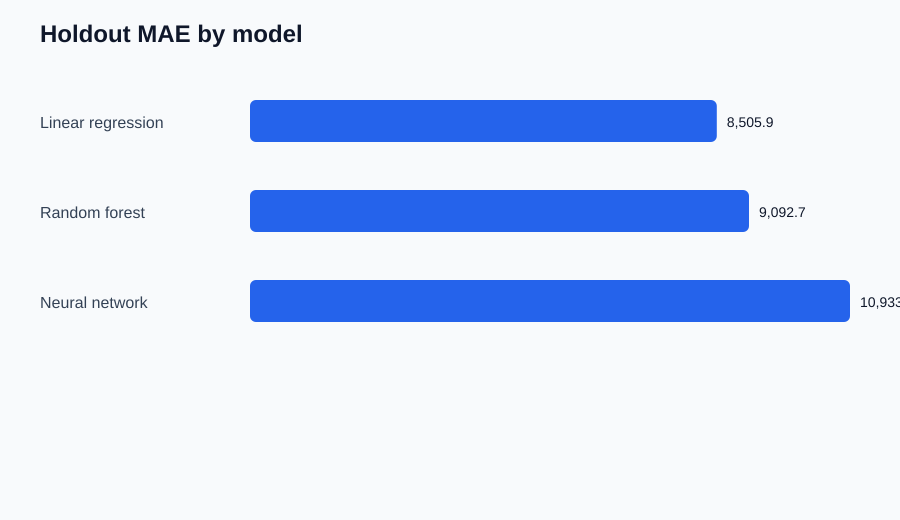
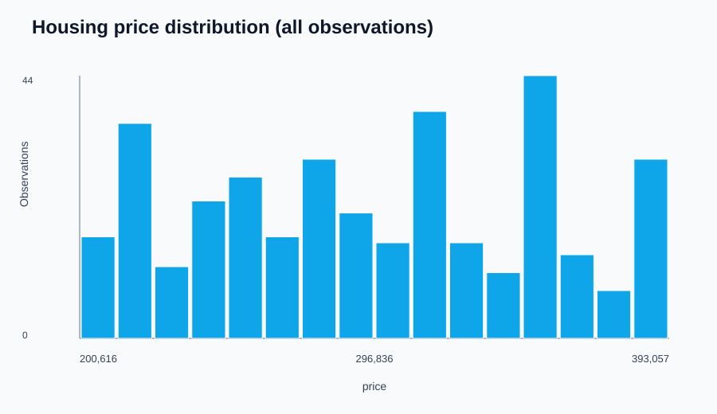
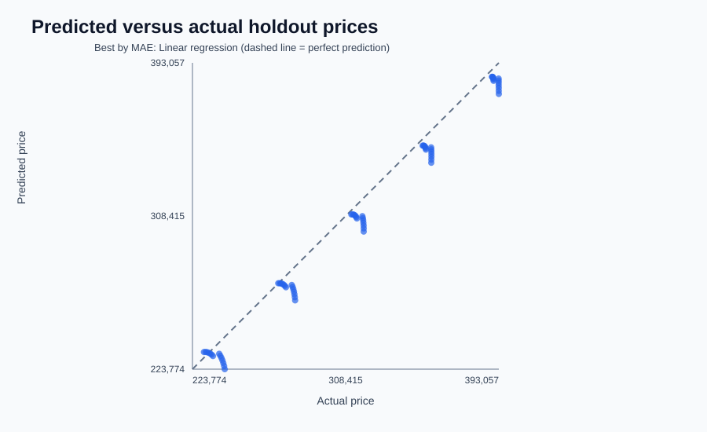

# Housing Market Intelligence

**Compare housing-price models. Explain their predictions. Test on later dates.**

Housing Market Intelligence is a reproducible Python project that prepares
monthly, multi-market housing data, compares three regression models on the
same time-based holdout, and produces evaluation tables, explainability
results, charts, a dashboard, and a local SQLite database.

> **Data disclosure:** The included dataset is deterministic synthetic demo
> data generated by this repository. It is not downloaded from a public source
> and does not represent actual US housing-market performance.

| At a glance | |
|---|---|
| Models | Linear Regression, Random Forest, Gradient Boosting |
| Evaluation | Same chronological 80/20 date split for every model |
| Metrics | MAE, RMSE, R² |
| Features | Inflation, mortgage rate, unemployment, fuel price, interest rate, synthetic market index |
| Deliverables | Comparison CSV, predictions, factor importance, SVG charts, HTML dashboard, SQLite |

## Results on the included demo data

The following scores are from the bundled synthetic data and the fixed
chronological holdout. They demonstrate that the pipeline runs; they are **not**
real-world housing-market evidence.

| Model | MAE | RMSE | R² |
|---|---:|---:|---:|
| Linear Regression | 8,505.90 | 9,995.42 | 0.9668 |
| Random Forest | 9,092.65 | 10,481.11 | 0.9635 |
| Gradient Boosting | 11,701.90 | 12,764.19 | 0.9458 |

The selected model is the one with the lowest holdout MAE. That identifies the
best result on this particular synthetic holdout, not a universally best model.
RMSE penalizes larger errors more strongly; R² measures fit relative to a
constant-mean baseline and may be negative.
Linear Regression performs best on this sample because the synthetic price
formula is largely linear in its economic indicators and market index. This is
an expected property of the generated demo, not a claim that real housing
markets are linear. Every row above comes from the exact same 80/20
chronological date split (290 training rows; 70 holdout rows).

## Visual results

Charts are generated from the same run as the score table:

**Model errors — MAE and RMSE (lower is better)**



**Housing-price distribution — all generated observations**



**Predicted versus actual prices — holdout, winning model**



Further plots include a chronological holdout prediction chart and feature
permutation importance. After a run, open `outputs\dashboard.html` for the
combined dashboard.

## Dataset and features

There is no external dataset source for the bundled demo. The dataset source is
the project's own deterministic generator, [`generate_sample_data.py`](generate_sample_data.py)
and its implementation in [`sample_data.py`](src/housing_market_intelligence/sample_data.py).
It creates 72 monthly observations (January 2018–December 2023) for five
fictional example markets (360 market-month rows). Generated prices are
constructed from a market baseline, a time trend, formula-driven economic
indicators, and a smooth cycle. These invented values are for testing and
visualization only.

| Feature | Meaning in the demo |
|---|---|
| `inflation_rate` | Synthetic inflation indicator |
| `mortgage_rate` | Synthetic mortgage-rate indicator |
| `unemployment_rate` | Synthetic unemployment indicator |
| `fuel_price` | Synthetic fuel-price indicator |
| `interest_rate` | Synthetic interest-rate indicator |
| `synthetic_region_index` | Numeric index assigned to the five fictional markets; not an observed economic statistic |
| `price` | Generated target price in fictional currency units |

In the generator, the illustrative target formula is:
`market baseline + month trend - 2,100 × mortgage rate + 900 × inflation - 1,250 × unemployment + market cycle`.
This deliberately simplified construction makes the demo reproducible; its
model scores must not be presented as results on a real-world dataset.

The project also generates separate housing, economic-indicator, area-lookup,
and future-input CSVs. This supports testing the optional date and `area_id`
joins without any network access. Preprocessing parses dates and numeric
columns, drops rows with invalid dates or missing target prices, removes
duplicate rows, joins optional macro data on date and area metadata on
`area_id`, and leaves missing predictor values for median imputation inside
each model pipeline. Imputation is learned from the training split to avoid
training/test leakage.

## Installation and run (Windows PowerShell)

Open PowerShell and run from the project folder:

```powershell
Set-Location 'C:\Users\sutew\OneDrive\Desktop\Housing_project\Housing-Market-Intelligence'
python -m venv .venv
.\.venv\Scripts\Activate.ps1
python -m pip install -r requirements.txt
python .\generate_sample_data.py
python .\housing_market_intelligence.py --data .\data\housing.csv --date-column date --target-column price --features inflation_rate,mortgage_rate,unemployment_rate,fuel_price,interest_rate,synthetic_region_index --forecast-csv .\data\future_economic_inputs.csv
```

If PowerShell prevents environment activation, use the virtual environment
interpreter directly instead:

```powershell
Set-Location 'C:\Users\sutew\OneDrive\Desktop\Housing_project\Housing-Market-Intelligence'
python -m venv .venv
.\.venv\Scripts\python.exe -m pip install -r requirements.txt
.\.venv\Scripts\python.exe .\generate_sample_data.py
.\.venv\Scripts\python.exe .\housing_market_intelligence.py --data .\data\housing.csv --date-column date --target-column price --features inflation_rate,mortgage_rate,unemployment_rate,fuel_price,interest_rate,synthetic_region_index --forecast-csv .\data\future_economic_inputs.csv
```

To open the optional desktop interface, run `python .\launch_gui.py` after
installing dependencies.

## Reproduce results and run tests

Regenerate the inputs, then rerun the analysis command above. Model and chart
outputs are deterministic: model random states and generator formulas are
fixed. Regenerating outputs overwrites the prior generated files.

Run the automated tests from the project root:

```powershell
python -m unittest discover -s tests -v
```

The tests cover input validation, date-based split isolation, macro/area joins,
monthly aggregation, all three models and metrics, generated charts and
dashboard, SQLite persistence, and future-period predictions.

## Output files

- `outputs\model_comparison.csv` — MAE, RMSE, and R² for all three models.
- `outputs\holdout_predictions.csv` — actual prices and each model's holdout predictions.
- `outputs\factor_importance.csv` — permutation importance for the lowest-MAE model.
- `outputs\future_predictions.csv` — winning-model predictions for supplied future inputs.
- `outputs\charts\*.svg` — standalone visualizations embedded above.
- `outputs\dashboard.html` — combined HTML report; open it in a browser.
- `outputs\housing_analysis.sqlite` — metrics, holdout predictions, and factor-importance tables.

Permutation importance measures predictive usefulness on this holdout; it
does not establish that an economic factor caused a price change. Forecasts
also require predictor values for future dates—the program does not forecast
the economic inputs itself.

See [architecture](doc/ARCHITECTURE.md), [program guide](doc/UNDERSTANDING.md),
and the [documentation README](doc/README.md) for details.
