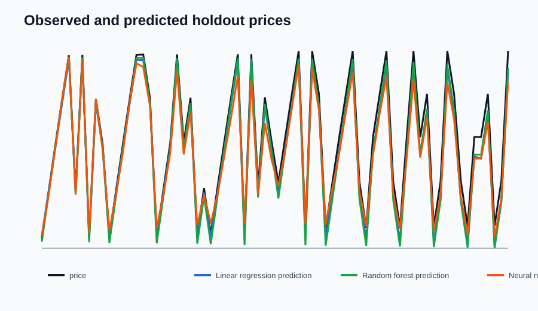
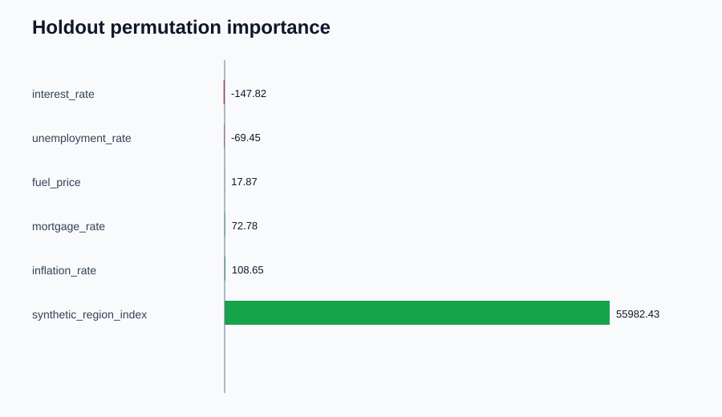

# Housing Market Intelligence

**Project owner:** Sameeksha Tewari

An independently implemented, self-contained housing analytics project. It
includes a data-preparation pipeline, three regression models, chronological
evaluation, economic-factor interpretation, future-period scoring, generated
charts, a local SQLite results database, a command-line interface, and an
optional desktop interface.

This project is a new implementation of the requested analysis capabilities;
it does not bundle source code, data, or images from the separate reference
project. Included CSVs are fictional demonstration data, not real market
observations.

## Project layout

```text
Housing-Market-Intelligence/
|-- data/                 Fictional, self-contained sample datasets
|-- doc/                  Project documentation
|-- outputs/              Generated analysis results
|-- src/housing_market_intelligence/
|   |-- cli.py            Command-line analysis workflow
|   |-- gui.py            Optional Tk desktop interface
|   |-- models.py         Linear, random-forest, and neural-network models
|   |-- preprocessing.py  Validation, joins, cleaning, monthly aggregation
|   |-- reports.py        CSV/JSON, SVG charts, and SQLite output
|   `-- sample_data.py    Deterministic synthetic data generator
|-- tests/                Automated workflow and data tests
|-- housing_market_intelligence.py
|-- launch_gui.py
|-- generate_sample_data.py
`-- requirements.txt
```

## Run the project on Windows PowerShell

Open PowerShell and copy these commands. The first command changes to the
project folder; the next commands create an environment, install dependencies,
and run the complete sample analysis:

```powershell
Set-Location 'C:\Users\sutew\OneDrive\Desktop\Housing_project\Housing-Market-Intelligence'
python -m venv .venv
.\.venv\Scripts\Activate.ps1
python -m pip install -r requirements.txt
python .\housing_market_intelligence.py --data .\data\housing.csv --date-column date --target-column price --features inflation_rate,mortgage_rate,unemployment_rate,fuel_price,interest_rate,synthetic_region_index --forecast-csv .\data\future_economic_inputs.csv
```

If PowerShell blocks virtual-environment activation, you can skip activation
and run the environment's Python directly:

```powershell
Set-Location 'C:\Users\sutew\OneDrive\Desktop\Housing_project\Housing-Market-Intelligence'
python -m venv .venv
.\.venv\Scripts\python.exe -m pip install -r requirements.txt
.\.venv\Scripts\python.exe .\housing_market_intelligence.py --data .\data\housing.csv --date-column date --target-column price --features inflation_rate,mortgage_rate,unemployment_rate,fuel_price,interest_rate,synthetic_region_index --forecast-csv .\data\future_economic_inputs.csv
```

To open the desktop app instead, run `python .\launch_gui.py` from the project
folder after setup. To rerun the analysis later, activate `.venv` first (if
needed), return to the project folder, and run the analysis command above.

The project uses Python, pandas, and scikit-learn. The desktop interface uses
Python's included Tkinter library. SVG visualizations are generated directly,
so a plotting library is not required.

## Included end-to-end example command

```powershell
python .\housing_market_intelligence.py --data .\data\housing.csv --date-column date --target-column price --features inflation_rate,mortgage_rate,unemployment_rate,fuel_price,interest_rate,synthetic_region_index --forecast-csv .\data\future_economic_inputs.csv
```

The example includes multiple synthetic market areas over monthly dates. The
`area_id` identifies a fictional market; the example model uses economic
indicators as predictors rather than treating the identifier as a numeric
economic measurement.

Regenerate all sample CSVs at any time:

```powershell
python .\generate_sample_data.py
```

## Analysis capabilities

- **Preparation:** validates date/target/predictor columns, converts values to
  numeric types, drops rows missing dates or prices, removes duplicate rows,
  joins time-indexed economic data, and optionally joins a market lookup.
- **Monthly aggregation:** `aggregate_monthly` is available in
  `preprocessing.py` for producing monthly mean prices, optionally grouped by
  market.
- **Model comparison:** evaluates linear regression, random forest, and a
  feed-forward neural network using a chronological holdout.
- **Scoring:** reports MAE, RMSE, and R-squared. The selected model is the
  lowest-MAE model on the holdout period.
- **Driver explanation:** ranks predictors with permutation importance on the
  holdout. Importance is predictive association, not proof of causation.
- **Future scoring:** predicts prices for dates in a second CSV when known
  predictor values are supplied. The program does not forecast economic inputs.
- **Reporting:** exports CSV and JSON summaries, original SVG charts, and a
  SQLite database with metrics, holdout predictions, and factor importance,
  plus a self-contained HTML dashboard.
- **Desktop UI:** starts a simple file-picker and run window with
  `python .\launch_gui.py`.

## Use different data

Historical CSV requires a date column, price target, and numeric feature
columns. Supply explicit feature names to exclude location identifiers or
other fields that should not be predictors.

```powershell
python .\housing_market_intelligence.py `
  --data .\data\housing_prices.csv `
  --macro-data .\data\economic_indicators.csv `
  --area-lookup .\data\area_lookup.csv `
  --date-column date `
  --target-column price `
  --features inflation_rate,mortgage_rate,unemployment_rate,fuel_price,interest_rate,synthetic_region_index `
  --forecast-csv .\data\future_economic_inputs.csv `
  --output-dir .\outputs `
  --train-fraction 0.8
```

The historical housing CSV can contain `area_id`; macro data joins on the
date column, and the optional area lookup joins on `area_id`. If no macro data
is passed, features must already exist in the historical CSV. A future CSV
must contain the date and every selected feature.

## Outputs

The output directory receives:

- `model_comparison.csv`
- `holdout_predictions.csv`
- `factor_importance.csv`
- `summary.json`
- `housing_analysis.sqlite`
- `dashboard.html`
- `future_predictions.csv` when future inputs are supplied
- `charts/model_comparison.svg`
- `charts/holdout_predictions.svg`
- `charts/factor_importance.svg`

SVG charts can be opened in a web browser or embedded in Markdown with a
relative path, for example ``.
Open `outputs\dashboard.html` in a browser for a combined report view.

### Generated chart previews






## Run automated tests

```powershell
python -m unittest discover -s tests -v
```

See [Architecture](ARCHITECTURE.md) and [Understanding the program](UNDERSTANDING.md)
for implementation details and model-interpretation caveats.
